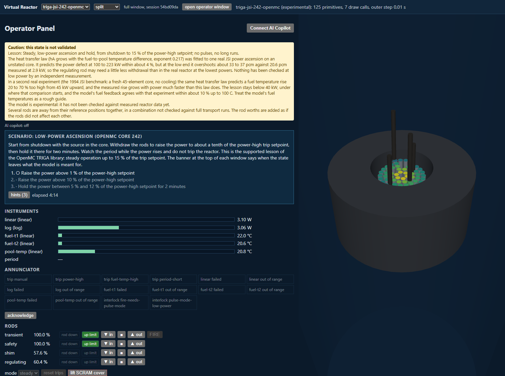
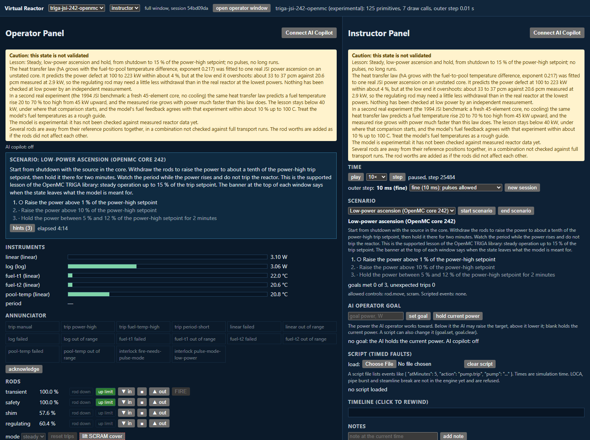

# RAFT (Reactor Agnostic Framework for Testing)

RAFT runs a simulated nuclear reactor in the browser. A reactor is described by a **library** (a folder with reactivity tables, kinetics, a plant definition and 3D power shapes) that OpenMC transport calculations build ahead of time; the live code only reads libraries, so it has no reactor built in. You can operate the reactor from a control-room panel, watch the power distribution change in a 3D view of the core, or act as an instructor who sets the pace and injects faults.

It is for students, instructors and reactor-physics hobbyists who want to see how a reactor responds to rod motion, feedback and faults, and for people who want to build libraries for other reactors.

**Status: experimental and educational. Results are not validated for safety, licensing or operation.** No library in this repository is marked validated; see [what has been compared with measurements](#what-has-been-compared-with-measurements) and [limits](#limits).



*The operator panel (instruments, annunciator, rod controls) beside the 3D core, on the low-power ascension scenario of the OpenMC-built TRIGA core 242. The yellow box is the app's own warning that the state is not validated.*

## What works

- **Physics:** point kinetics with six delayed-neutron groups, fuel and coolant temperature feedback, xenon and iodine, rod motion and scram, trips and interlocks, instrument noise and faults. A Python reference engine (`physics_ref/`) and the TypeScript engine the browser runs (`web/src/sim/`) produce the same results on shared golden vectors. A library may also declare soluble boron (an operator-set concentration that moves at a limited rate); see [docs/library-format.md](docs/library-format.md).
- **Views:** an operator panel that shows instruments only (no true values), a 3D explorer with power overlays, and an instructor panel with time control, rewind, branches, notes, fault injection, session files and two linked windows.

  

  *The instructor layout: the operator panel on the left, the instructor panel on the right.*

- **Scenarios:** short exercises with goals and a score (low-power ascension, scram and restart).
- **Libraries in the app:** the TRIGA Mark II research reactor of the Jožef Stefan Institute in Ljubljana, cores 242 and 246, built with OpenMC from open data; an earlier TRIGA library for core 242 whose values are mostly assumed; and a synthetic test core. All are `experimental` or synthetic. Core 134 (fresh fuel, the 1994 benchmark) is built too but is not in the app. [docs/validation/supported-envelope.md](docs/validation/supported-envelope.md) says which lesson the app supports and under what warnings.
- **Headless runner:** `node web/dist-headless/raft-headless.mjs run <case.json>` runs a scripted case without a browser; see [docs/headless.md](docs/headless.md).
- **Optional AI assistant:** the operator panel has an "AI Copilot" button that asks a local classifier model to pick among actions the runtime has already checked. It never invents an action. See [AI assistant](#ai-assistant-optional).

## What has been compared with measurements

Every comparison was written as a protocol before it was run, run once, and reported with its failures ([docs/validation/](docs/validation/)).

- **TRIGA steady power ascension:** the OpenMC-built libraries disagree with the measured data: the model's power defect at 250 kW is 0.45 to 0.47 of the measured one. The cause is only partly understood.
- **TRIGA core 134 (fresh fuel):** the regulating rod's reactivity curve is within the benchmark's stated scale; the other rods' worths are 12 to 31 percent too high, the temperature feedback is too weak, and its power ascension is parked. See [docs/validation/core134-status.md](docs/validation/core134-status.md).
- **A TRIGA fuel pin cell against a Serpent reference:** OpenMC's temperature response is 15 to 18 percent weaker than the reference with either nuclear-data evaluation tried; unexplained.
- **PWR hot zero power (BEAVRS, cycle 1):** the transport model reproduces the measured critical boron at five rod configurations within the benchmark's own uncertainty, the shutdown banks' total worth to a fraction of a percent, but its isothermal temperature coefficient is 1.6 to 2.0 pcm/°F too negative. See [docs/validation/m8-beavrs-hzp-results.md](docs/validation/m8-beavrs-hzp-results.md). A PWR library built from it (`pwr-beavrs-hzp-openmc`, with lessons on approach to criticality by dilution and by bank withdrawal) is in the app. Against the same measurements its critical boron is within 24 ppm at all five rod states (a correction for banks shadowing each other was fitted to twelve transport cases, three of them at those states), checked against 19 further transport cases that converged (20 were run), and its temperature coefficient fails and does not follow the rods ([docs/validation/m8-rod-shadowing-results.md](docs/validation/m8-rod-shadowing-results.md), [docs/validation/m8-near-critical-results.md](docs/validation/m8-near-critical-results.md)).

## Limits

- TRIGA first: the supported exercise is a low-power ascension on one library. Pulses, long xenon runs and high power are not supported by evidence.
- Point kinetics with one fuel node and one coolant node: no spatial kinetics, no flow loop, no decay heat, no pressure model.
- Rod worths are added as if the rods acted alone; only a few combinations were checked against transport runs, and the app says so when you leave them.
- Many plant values (trip setpoints, instrument ranges, rod speeds) are assumed and labelled as such in each library.
- The 3D power shapes and rod worths carry the statistical error of the transport runs that produced them.
- The AI assistant has not been shown to do better than a person or a plain controller. [docs/validation/ai-operator-baseline.md](docs/validation/ai-operator-baseline.md) is a comparison against a fixed-rule baseline, and says what it does not show.

## Install and first run

Needs Node 24 or newer and Python 3.11 or newer. Tested on Windows 11. The library builder also needs OpenMC and nuclear data (below); the app does not.

```bash
cd web
npm ci
npm run dev        # prints a local address; open it in a browser
```

Checks (from the repository folder):

```bash
python -m unittest discover -s pipeline/tests -t .
python -m unittest discover -s physics_ref/tests -t .
cd web && npm test
```

Build the headless runner: `cd web && npm run build:headless`.

## Building a library (optional)

`pipeline/` turns OpenMC runs into a library (`python -m pipeline.library.export_openmc`, see [docs/plans/02-openmc-pipeline.md](docs/plans/02-openmc-pipeline.md)). This needs OpenMC 0.15 and an ENDF/B-VIII.0 HDF5 library, installed separately; neither is included, and the runs take hours. The finished libraries are in `libraries/`, so you do not need to rebuild them to use the app. Writing a library for another reactor: [docs/library-format.md](docs/library-format.md) is the format.

## AI assistant (optional)

`jev-server/` is a small local server for the assistant (Python; `run-jev-server.cmd` on Windows). It uses the **Mica-v0.1-4B** classification model, which is not part of this repository and is about 4.7 GB with its runtime. Get it from Hugging Face (`sky7350/Mica-v0.1-4B`, a fine-tune of Qwen3.5-4B, Apache-2.0 according to its model card), and put the folder named `Mica-v0.1-4B` next to this repository's folder; read the licence and NOTICE files that come with it before redistributing anything. A graphics card helps but is not required. Without the server or the model the app works; the AI Copilot button just does not connect.

## Licence and sources

MIT (`LICENSE`). Third-party code and data, and anything installed separately, are listed in [THIRD_PARTY_NOTICES.md](THIRD_PARTY_NOTICES.md). The measured data used for the TRIGA comparisons (the JSI pulse database, IAEA steady-power numbers and the core 134 tables) are not distributed here, because redistribution permission is not confirmed; tests that need them skip, and the validation notes quote the numbers they used. The BEAVRS benchmark (MIT licence) is used for the PWR work.

More: [PLAN.md](PLAN.md) for the design, [docs/ARCHITECTURE.md](docs/ARCHITECTURE.md) for how the parts fit together.
